# Relay

**An AI-native, governed HR services platform for TBO.** Built for VoyageHack 4.0, problem statement 6 (Darwinbox).

> Agents do the routine HR work end to end across IT, Admin, Finance and the hiring manager.
> People make every decision with legal, financial or human consequences.
> Every action is policy-checked, audited and costed in INR.

**Live demo:** https://relay-hr-console.vercel.app. This is the HR console on synthetic demo data. Any demo account works; see [Demo accounts](#demo-accounts).

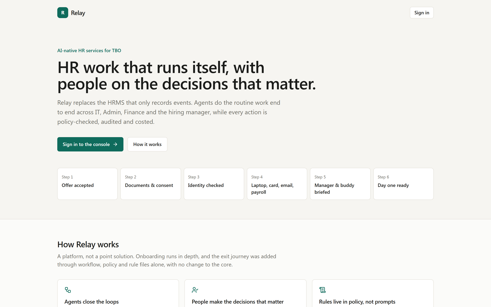

---

## Contents

1. [The problem](#1-the-problem)
2. [What Relay does](#2-what-relay-does)
3. [How Relay meets the eight objectives](#3-how-relay-meets-the-eight-objectives)
4. [Architecture](#4-architecture)
5. [The life of one step](#5-the-life-of-one-step)
6. [Onboarding, in depth](#6-onboarding-in-depth)
7. [Product tour (screenshots)](#7-product-tour)
8. [Governance: guarantees enforced in code](#8-governance-guarantees-enforced-in-code)
9. [A platform, not a point solution](#9-a-platform-not-a-point-solution)
10. [AI, models and personal data](#10-ai-models-and-personal-data)
11. [Cost and impact, in numbers](#11-cost-and-impact-in-numbers)
12. [Serving people where they work: Slack](#12-serving-people-where-they-work-slack)
13. [Tech stack](#13-tech-stack)
14. [Quality and testing](#14-quality-and-testing)
15. [Quick start](#15-quick-start-fresh-clone-to-running-demo)
16. [Repository layout and documents](#16-repository-layout-and-documents)
17. [Suggested slide outline](#17-suggested-slide-outline)
18. [Team, AI tools and licences](#18-team-ai-tools-and-licences)

---

## 1. The problem

An HRMS today **records** events, but people still **move** the work. When TBO hires someone:

- HR emails IT for a laptop, Admin for an access card and Finance for payroll setup. Then HR chases each one.
- Documents arrive in pieces. Someone checks by eye whether the PAN name matches the offer.
- Decisions that carry real consequences sit in inboxes with no deadline and no context: offers, probation, resignations, the full and final settlement.
- Nobody can say what one onboarding costs, how long it takes, or how much of it needed a person.

The brief asks for an **agent-first platform that could replace a conventional HRMS**. Agents should close those loops on their own. Humans should keep the decisions that matter. It should run at a low, measured cost per task. And TBO's own developers must be able to extend it to new service lines.

## 2. What Relay does

Relay is a **governed workflow runtime for HR**.

| | |
|---|---|
| **One trigger, the whole journey** | An accepted offer starts one onboarding run. Relay verifies the offer, collects documents and consent, cross-checks identity, and then works in parallel. It provisions the account, orders the laptop, issues the access card, sets up payroll and PF, assigns a buddy, briefs the manager and schedules day one. Nobody sends an email or a follow-up. |
| **People on the decisions that matter** | Offers, probation, resignations, full and final settlements, policy exceptions and DPDP erasure go to a **named person**. An agent can never approve them, whatever its prompt says. |
| **Rules in policy, not prompts** | Labour rules, approval limits, RBAC and the reserved-decision list are versioned YAML. HR edits it, tests it and activates it from the console. |
| **Fails safely** | When a system is down, data conflicts or an agent is unsure, the work goes to a person with the context attached. Retries never order two laptops. |
| **Audited and explainable** | Every action has a Decision row and an entry in the hash-chained audit log. That entry records who or what acted, under which policy, workflow, prompt and model version, and what personal data left the system. |
| **Costed in rupees** | Model tokens, CPU and infrastructure are metered per step and per run. The dashboard shows automation, cycle time, escalation and cost per workflow. |

Three service lines run on one core:

- **Onboarding**: the depth vertical.
- **Exit**: the extension proof.
- **DPDP data requests**: access, correction and erasure. Erasure is reserved for HR Admin.

Exit and DPDP were each added **without changing `relay/core/`**.

## 3. How Relay meets the eight objectives

| # | Objective (PS6) | How Relay meets it | Where to see it |
|---|---|---|---|
| 1 | Automate end to end | One run closes the loops with IT, Admin, Finance and the manager through connectors and agents. The step automation rate is reported. | Dashboard, Runs |
| 2 | Platform, not point solution | Workflows, policies, skills, prompts and connectors are versioned definitions with a registry. Exit and DPDP were added with zero core change, and CI checks this. | Registry, `definitions/`, [developer guide](docs/developer-guide.md) |
| 3 | Humans on the decisions that matter | The reserved-decision floor is in code. HR config can only add to it. Agents and system actors can never get `ALLOW` on a reserved action. | Inbox, Policies |
| 4 | Comply by design | Labour rules, approvals, retention and DPDP are versioned, tested policy packs. Every decision is stamped with the policy version. | Policies (edit, test, activate, roll back) |
| 5 | Clean system of record | Postgres data model from hire to exit, role-based access, and a hash-chained audit trail of every change and who or what made it. | Employees, Audit |
| 6 | Fail safely | Low confidence, outages and data conflicts become tasks with a context packet. An idempotency ledger means exactly-once side effects. Kill switches. | Inbox, Controls (fault injection) |
| 7 | Serve people where they work | A Slack app handles chat intake, decision cards, reminders and escalations. The console has "Ask Relay" chat backed by the policy handbook. | Slack, Ask Relay |
| 8 | Prove cost and impact | Measured cost per completed workflow, automation rate, cycle time p50/p90 and escalation rate. | Dashboard |

## 4. Architecture

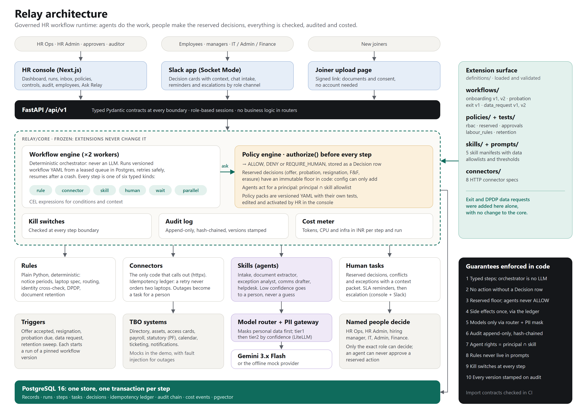

*Source: [docs/images/architecture.svg](docs/images/architecture.svg). The full write-up is [docs/architecture.md](docs/architecture.md).*

**Read it top to bottom:**

1. **Interfaces.** People reach Relay through:
   - the **HR console** (Next.js);
   - the **Slack app**;
   - a **signed upload link** for joiners.

   All three call one **FastAPI** service, with Pydantic contracts at every boundary.
2. **The core** (`relay/core/`) is frozen for extensions:
   - **Workflow engine.** A deterministic interpreter (never an LLM) runs versioned workflow YAML from a leased queue in Postgres. Two workers run in parallel. A crashed worker's lease expires and another worker takes the step over.
   - **Policy engine.** `authorize()` runs before every step and returns `ALLOW`, `DENY` or `REQUIRE_HUMAN`, stored as a **Decision** row.
   - **Kill switches, audit log and cost meter.** These wrap every step.
3. **Executors.** Each step is one of six typed kinds:
   - **Rules**: plain Python.
   - **Connectors**: the only code allowed to make HTTP calls, with an idempotency ledger. They call TBO's systems.
   - **Skills**: agents. They reach a model only through the **model router and PII gateway**.
   - **Human tasks**: routed to a named role.
4. **PostgreSQL 16** holds everything durable:
   - records, runs, tasks and decisions
   - the ledger and the audit chain
   - cost events and vectors

   One transaction updates a step, writes its audit event and records its cost, so they can never disagree.
5. **The extension surface** (`definitions/`) is where TBO's developers work. New service lines are definitions plus rule functions, not core changes.

The same diagram as text (for slide tools that take Mermaid):

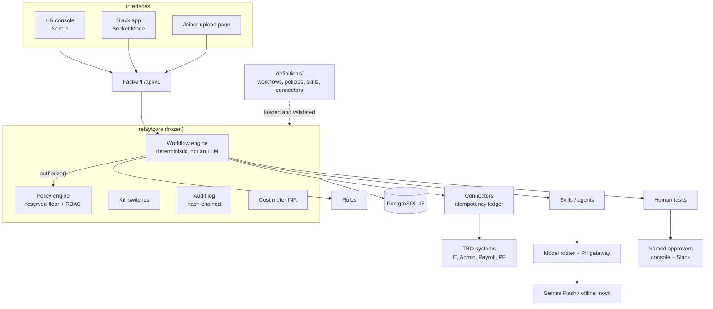

## 5. The life of one step

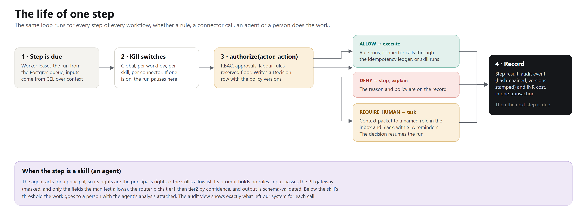

Every step of every workflow goes through the same loop:

1. **Lease.** A worker leases the run from the Postgres queue.
2. **Kill switches.** The worker checks them: global, per workflow, per skill and per connector.
3. **`authorize()`.** The worker asks the policy engine.
4. **Act on the decision:**
   - **`ALLOW`**: the step runs.
   - **`DENY`**: the step stops with the reason.
   - **`REQUIRE_HUMAN`**: a task goes to a named role with a context packet. Their decision resumes the run.
5. **Record.** The result, the audit event (hash-chained and stamped with the policy, workflow, prompt and model versions) and the INR cost are written in one transaction.

## 6. Onboarding, in depth

```mermaid
flowchart LR
  O[Offer accepted] --> V[Verify offer<br/>rule]
  V --> EC[Create employee<br/>connector]
  EC --> T[Compute terms<br/>rule]
  T --> DR[Request documents<br/>+ DPDP consent]
  DR --> W[Wait for joiner<br/>wait]
  W --> X[Extract documents<br/>skill]
  X --> CC{Cross-check identity<br/>rule}
  CC -- conflict --> HT[HR Ops decides<br/>human, with analysis]
  CC -- match --> ACT[Activate employee id]
  HT --> ACT
  ACT --> PAR
  subgraph PAR[In parallel]
    ID[Provision identity]
    LS[Select laptop spec] --> LO[Order laptop<br/>over ₹1.5L needs IT spend approval]
    AC[Issue access card]
    PY[Set up payroll]
    PF[Register PF]
    BU[Assign buddy]
  end
  PAR --> NM[Brief manager<br/>skill]
  NM --> D1[Schedule day one]
  D1 --> PA[Policy acknowledgements<br/>wait]
  PA --> PR[Probation run<br/>reserved: manager confirms]
```

What happens to the people involved:

- **The joiner** gets a signed link and uploads their documents and consent. Nothing else.
- **HR Ops** sees only the exceptions, such as *"PAN name does not match the offer"*. Each comes with the agent's analysis, the likely cause and one-click options.
- **IT, Admin and Finance** never get an email. Their systems are called through connectors. If a system is down, the run waits and retries without duplicating, and a person is told.
- **The hiring manager** gets a brief about the joiner and, later, the **reserved** probation decision.
- **Approvers** are asked only when policy says so. For example, a laptop over ₹1.5L needs IT spend approval *(TBO IT Asset Policy §2.3)*.

## 7. Product tour

All screenshots are from the live console on synthetic demo data (`web/scripts/screenshots.mjs` regenerates them).

### Sign in

Demo accounts sign in with one click. Each role sees what it may act on.

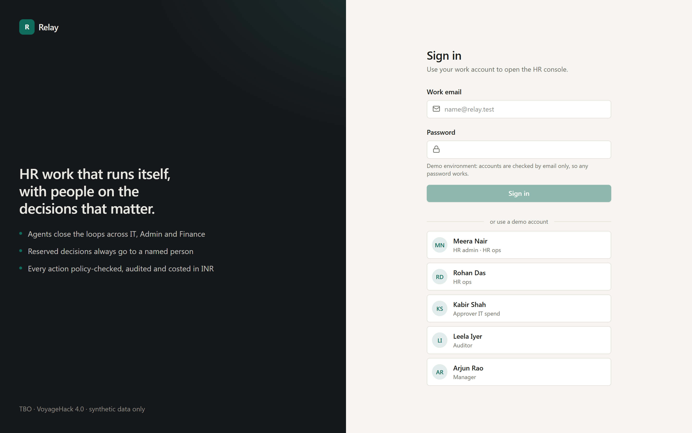

### Dashboard: impact and cost

Shows step automation, straight-through rate, human escalation, cycle time p50/p90 and cost per workflow in INR, split by workflow.

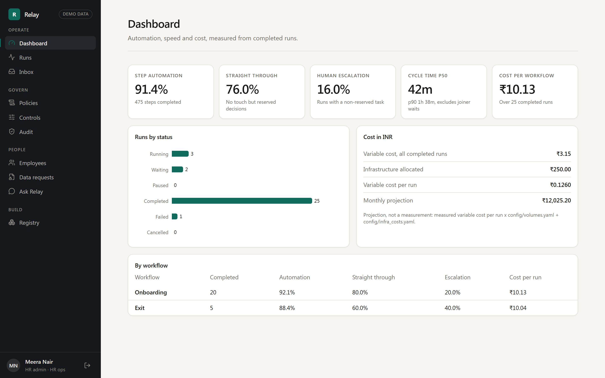

### Runs

Every workflow run, with its status, progress and cost.

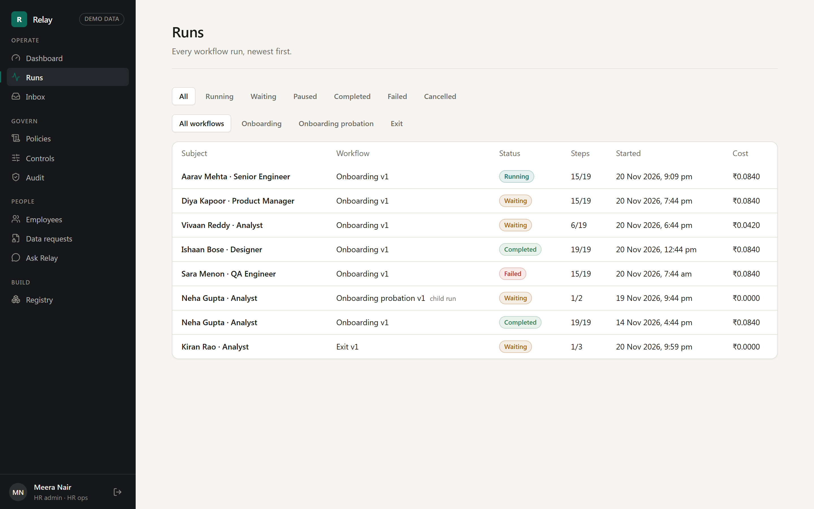

### Run detail: the step graph and the audit timeline

Each step shows its typed kind, its policy decision and the reason, the rule that fired, the policy versions, the model, the prompt version and the cost. Here the laptop order is waiting for IT spend approval because it is over ₹1.5L.

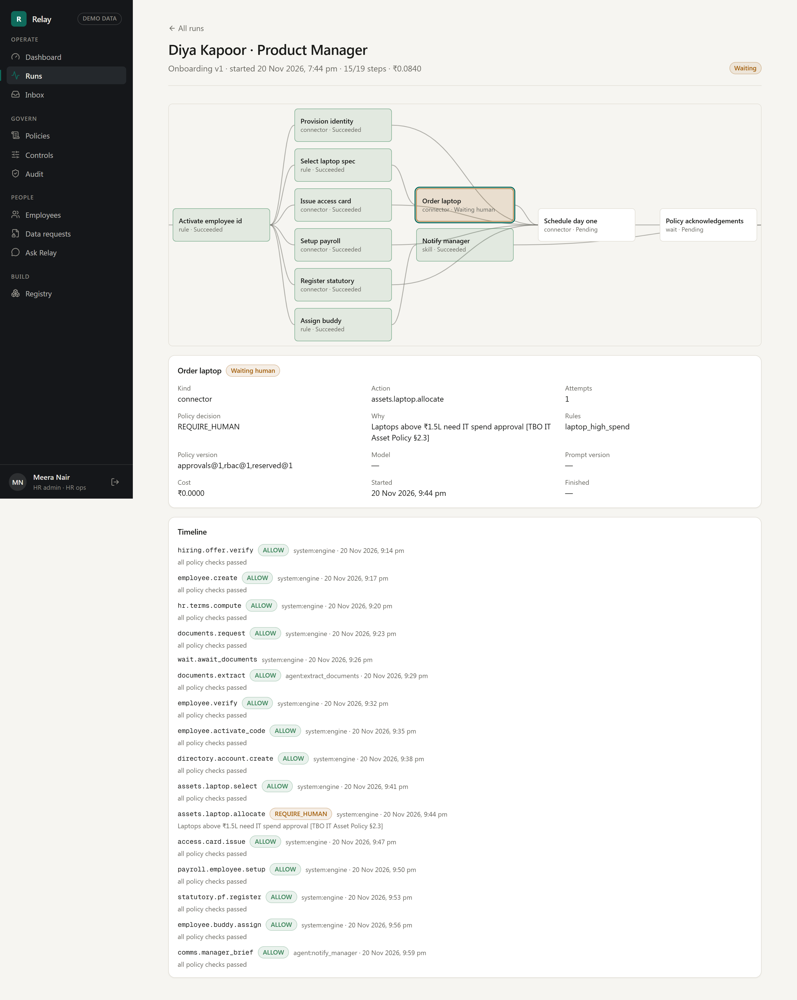

### Inbox: people decide, with the context to decide

Reserved decisions (probation, resignation) go to the named role. Conflicts arrive with the agent's analysis and suggested actions.

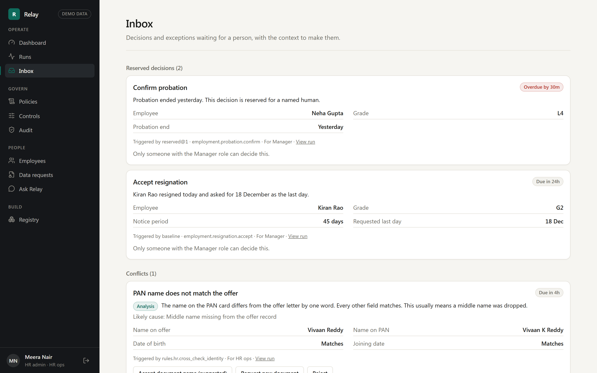

### Policies: rules HR can edit, test and activate

Policy packs are versioned YAML with test cases. Here the laptop approval limit is lowered from ₹1.5L to ₹1L. The tests run before activation, and rollback is one click.

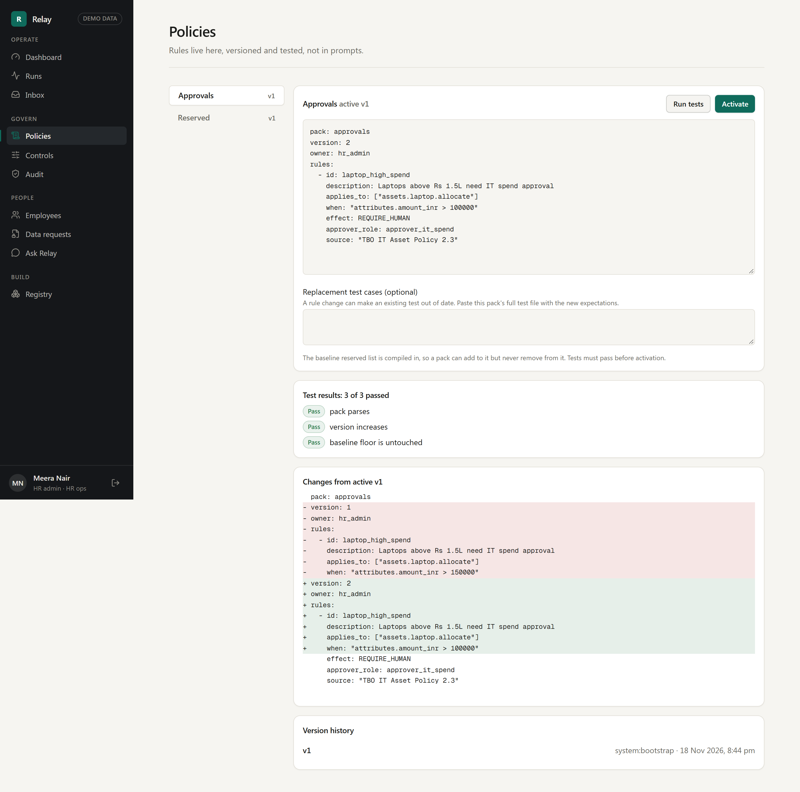

### Controls: kill switches and fault injection

Pause everything, one workflow, one skill or one connector. Inject outages into the mock TBO systems to show safe failure live.

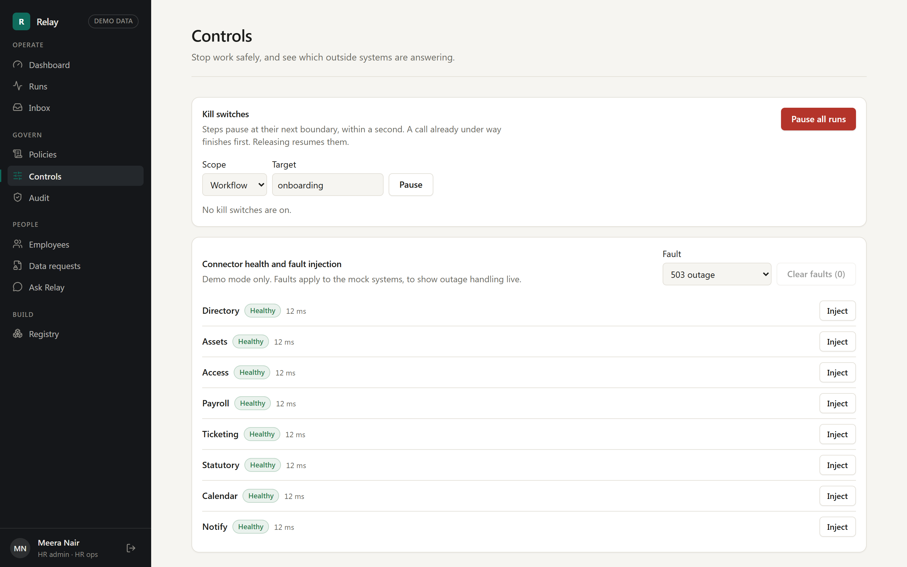

### Audit: hash-chained, with "what left our system"

Every event records who or what acted and under which versions. For model calls, it shows exactly which fields were sent (masked) and to which provider and region.

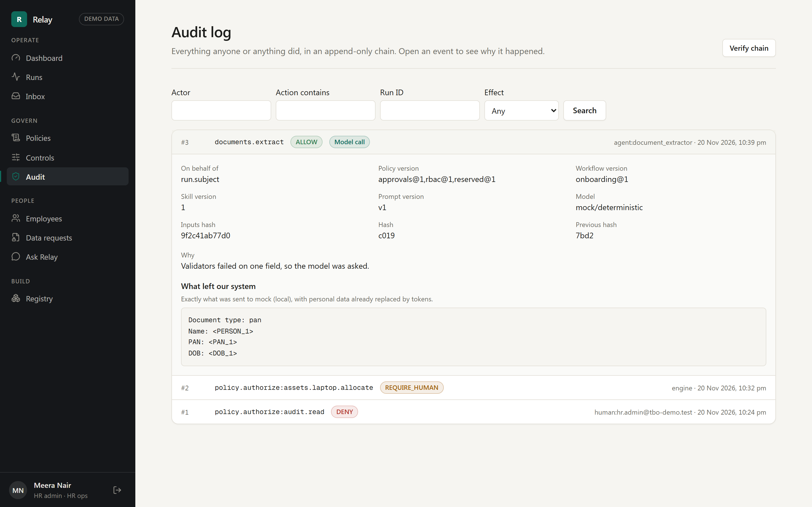

### Employees: the system of record

Each employee's lifecycle from hire to exit, with workflows, documents, consents and data requests.

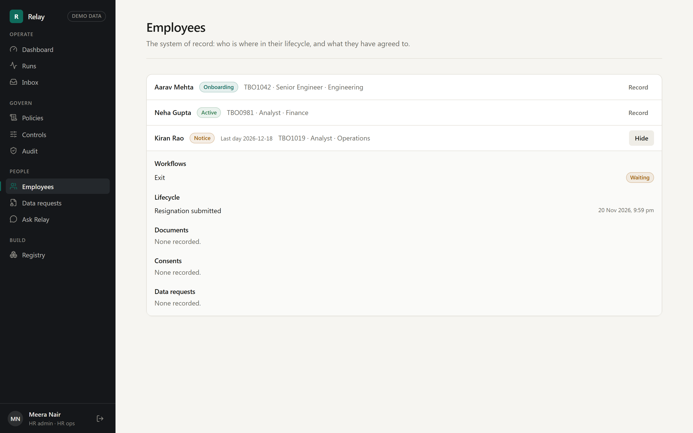

### Data requests (DPDP)

Access, correction and erasure requests. Erasure is weighed against retention law and reserved for HR Admin.

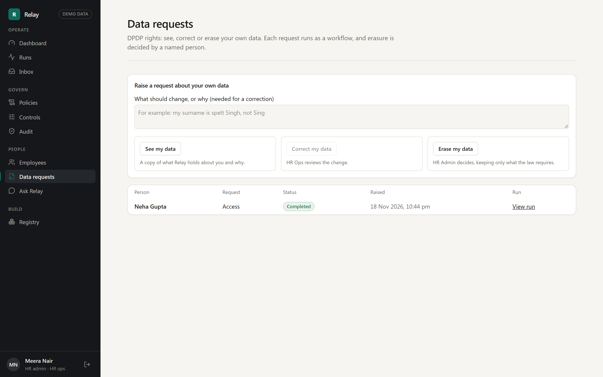

### Ask Relay

Employees ask in plain language. Answers cite the policy they come from, and requests start the right workflow.

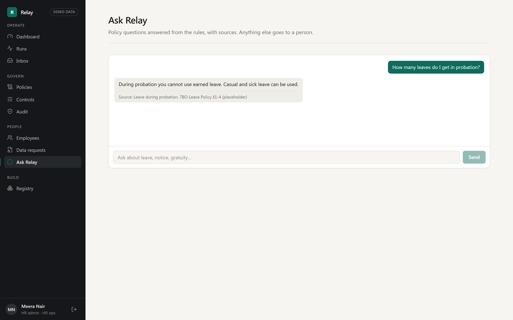

## 8. Governance: guarantees enforced in code

These are the non-negotiables from PRD Section 6. Each is enforced by code, tests or import contracts, not by convention.

| # | Guarantee | How it is enforced |
|---|---|---|
| 1 | Step kinds are typed; the orchestrator is never an LLM | JSON schema on workflows; the engine is an interpreter |
| 2 | No action without a Decision row | The engine calls `authorize()` before every step |
| 3 | Reserved decisions have an immutable floor | A baseline in code; config can only add; agents and system actors never get `ALLOW` |
| 4 | External side effects exactly once | Connectors only, through the idempotency ledger. Only `relay.connectors` may import `httpx` |
| 5 | Model calls only through the router and PII gateway | Only `relay.models.router` may import `litellm` (import-linter contract) |
| 6 | Audit log is append-only and hash-chained | Chain verification and tests |
| 7 | Agents act on behalf of a principal | Permissions = principal ∩ skill allowlist |
| 8 | Rules never live in prompts | Rules are Python and policy YAML; prompts only word things |
| 9 | Kill switches at every step boundary | Checked by the engine on every step |
| 10 | Everything versioned is stamped on audit events | Policy, workflow, prompt and model versions on every event |

**Reserved for a human:** a minimum set from the brief, which HR can extend in `definitions/policies/reserved.yaml`:

- hiring decisions, offer approval and compensation
- accepting a resignation and agreeing the release date or notice buyout
- termination, discipline and PIPs
- salary, grade or role changes and policy exceptions
- POSH, grievances and investigations
- probation confirmation
- laptop allocation exceptions
- DPDP erasure

## 9. A platform, not a point solution

TBO's developers extend Relay through **definitions**, not core changes. The [developer guide](docs/developer-guide.md) has the details.

| To add | You write | Core change |
|---|---|---|
| A service line | `definitions/workflows/<name>.v1.yaml` + rule functions in `relay/rules/` | None |
| A policy | `definitions/policies/<pack>.yaml` + test cases in `definitions/policies/tests/` | None |
| An agent (skill) | `definitions/skills/<name>.yaml` (data allowlist, tier, threshold) + a prompt | None |
| An integration | `definitions/connectors/<name>.yaml` | None |

**Proof:**

- **Exit** (resignation to full and final) was added through workflow, policy and rule files alone. Two reserved decisions stop it for named people: the manager accepts the resignation, and Finance signs off the full and final.
- **DPDP data requests** were added the same way, with erasure reserved for HR Admin and an audited export.
- **Probation** and a **document retention sweeper** followed the same path.

A CI job fails any extension PR that touches `relay/core/`. `relay validate` checks every workflow against the schema, the policy catalogue and every reference before it is stored. Stored versions are immutable, and running work keeps the version it started with.

## 10. AI, models and personal data

- **Agents do judgement, rules do decisions.** Five skills:
  - intake classification
  - document extraction
  - exception analysis
  - comms drafting
  - the helpdesk

  Dates, notice periods, eligibility, routing and approvals are rules.
- **Model router.** Each skill uses `tier1` first and escalates to `tier2` by confidence. Below the skill's threshold, the work goes to a person. Thresholds come from an eval harness that minimises expected cost, including the cost of an error and of an HR person's time ([evals/threshold_report.md](evals/threshold_report.md)).
- **Providers.** Relay calls models through LiteLLM. It is wired for **Google Gemini** (3.x Flash-Lite and Flash) and also has an **offline mock provider**, so the demo and the tests run with no key and no network.
- **PII gateway.** A skill's manifest lists the fields it may see. Everything else is dropped, and identifiers are masked before any model sees them. The audit view shows "what left our system" for each call, and [docs/pii-inventory.md](docs/pii-inventory.md) is generated from the manifests.
- **Synthetic data only.** The demo has no real personal data.

## 11. Cost and impact, in numbers

**Measured** on the real engine, rules and connectors with the offline model, from `relay simulate` over the 37 seed candidates:

| Measure | Value |
|---|---|
| Onboarding runs completed | 34 of 37 (2 waiting on a joiner, 1 refused for an unapproved offer) |
| Steps finished with no human touch | **98.75%** |
| Model calls per onboarding | 1.26 |
| Tokens per onboarding (in / out) | 191 / 20 |
| Model cost per onboarding | ₹0.0025 at placeholder prices |

**Cost formula** (PRD 17):

```
cost_run    = Σ llm(tokens_in × p_in + tokens_out × p_out) + Σ cpu_seconds × p_cpu + infra_alloc
monthly_inr = Σ_workflow volume × variable cost per run + monthly fixed infra
```

Most of the work needs no model at all. A model is called only where wording or judgement helps, and each call is capped. Even at ₹25 / ₹100 per 1k tokens, the model cost per onboarding would be about ₹6.78. The rest of the derivation is in [docs/cost-projection.md](docs/cost-projection.md).

The console dashboard in the live demo shows the same metrics on illustrative demo data:

- 91.4% step automation
- 16% human escalation
- 42-minute p50 cycle time
- ₹10.13 per workflow, including ₹10 of allocated infrastructure

## 12. Serving people where they work: Slack

The Slack app (`relay/slack/`, Socket Mode) gives people:

- **Decision cards** with the summary, key facts and the rule that triggered them. Approve or reject in one click. A reason modal opens where policy needs one. Only the exact role may decide, and every click passes `authorize()`.
- **Routing.** Cards go to the named assignee's DM, or else to role channels: `#hr-ops`, `#it-fulfilment`, `#admin-fulfilment`, `#finance-ops`, `#approvals`.
- **SLA reminders, then escalation** to the next level, all audited.
- **Chat intake.** Employees DM Relay ("my salary slip looks wrong") and it routes the request or answers from the handbook.

Setup is in [docs/slack.md](docs/slack.md). A Microsoft Teams adapter can be added beside it with no core change ([docs/teams.md](docs/teams.md)).

## 13. Tech stack

| Layer | Choice |
|---|---|
| Backend | Python 3.12, FastAPI, Pydantic v2, SQLAlchemy 2 + Alembic, Typer CLI |
| Engine and policy | Own interpreter over Postgres (`FOR UPDATE SKIP LOCKED` leases), CEL expressions (cel-python) |
| Data | PostgreSQL 16 (+ pgvector): system of record, queue, ledger, audit, cost |
| Models | LiteLLM router → Google Gemini, or an offline mock; regex PII gateway (Presidio optional) |
| Integrations | httpx connectors; mock TBO systems with fault injection (`mocks/`) |
| Chat | Slack Bolt (Socket Mode) |
| Console | Next.js 15, React, TanStack Query, Tailwind CSS; deployed on Vercel |
| Quality | pytest, hypothesis, ruff, mypy (strict), import-linter, Playwright |

## 14. Quality and testing

- **533 Python tests**, grouped into:
  - unit
  - policy packs
  - simulation (full workflows on a fast clock)
  - chaos (workers killed mid-step: no duplicate side effects)
  - end to end
- **26 Playwright tests** for the console.
- **Policy tests** run for every policy pack before it can be activated.
- **Quality gate**, run before every PR:

  ```
  ruff check · ruff format --check · mypy --strict · lint-imports · pytest
  ```

- **Import contracts** keep `httpx` in connectors and `litellm` in the router, and keep extensions out of `relay/core/`.

## 15. Quick start: fresh clone to running demo

You need Docker, Python 3.12, [uv](https://docs.astral.sh/uv/) and Node 20+.

Everything runs offline:

- The mock TBO systems stand in for the real ones.
- Skills use the offline `mock` model provider until a key is set.

Target: 10 minutes or less.

**1. Configure.**

```bash
cp .env.example .env
uv run relay config gen-key       # paste the output into .env as RELAY_ENCRYPTION_KEY
```

To use Gemini, set `GEMINI_API_KEY` in `.env` and choose the tiers there. `.env.example` lists the variables.

**2. Start the backend.** This starts Postgres, the mock TBO systems, the API and two engine workers.

```bash
docker compose up -d --build
```

The API container applies migrations and creates the demo users on start. To check it:

```bash
curl http://localhost:8000/api/v1/health
```

**3. Load the synthetic seed and play the demo scenarios.**

```bash
uv sync
uv run relay seed load            # 46 employees, 37 candidates, 5 exits (synthetic only)
uv run relay simulate             # every PRD 22 scenario through onboarding on a fast clock
```

- Add `--workflow exit` (or `all`) to also play the five seed resignations.
- `uv run relay demo` rehearses the five-minute demo. For each step it shows what to present and whether the data it needs is there.

**4. Open the HR console.**

```bash
cd web
npm install
NEXT_PUBLIC_RELAY_API_URL=http://localhost:8000 npm run dev
```

Open http://localhost:3000.

On Windows PowerShell, set the variable first:

```powershell
$env:NEXT_PUBLIC_RELAY_API_URL="http://localhost:8000"; npm run dev
```

If you leave `NEXT_PUBLIC_RELAY_API_URL` unset, the console runs on built-in demo fixtures. The Vercel deployment works this way.

**5. Optional: Slack.** Follow [docs/slack.md](docs/slack.md), then run:

```bash
uv run relay slack
```

### Demo accounts

**Live demo (fixtures):** any password works.

| Account | Role |
|---|---|
| Meera Nair, `hr.admin@tbo-demo.test` | HR Admin + HR Ops |
| Rohan Das, `hr.ops@tbo-demo.test` | HR Ops |
| Kabir Shah, `it.approver@tbo-demo.test` | IT spend approver |
| Leela Iyer, `auditor@tbo-demo.test` | Auditor |
| Arjun Rao, `manager@tbo-demo.test` | Hiring manager |

**Local backend:**

- Asha (HR Ops), `hr.ops@relay.test`
- Vikram (HR Admin), `hr.admin@relay.test`
- approvers, IT/Admin/Finance ops, the auditor, a developer, and each seeded manager

### Developing

```bash
docker compose up -d postgres     # just Postgres, on host port 55432
uv sync
uv run relay db upgrade
uv run relay validate             # every workflow against schema, policies and references
uv run relay policy test          # policy packs against their test cases
uv run pytest -q                  # DB tests skip if Postgres is not running
```

The quality gate (same as CI):

```bash
uv run ruff check relay tests && uv run ruff format --check relay tests && uv run mypy relay && uv run lint-imports && uv run pytest -q
```

On Windows, run `lint-imports` with `PYTHONIOENCODING=utf-8`.

To regenerate the README images:

```bash
cd web
node scripts/screenshots.mjs                                               # 12 console screenshots
node scripts/render-svg.mjs ../docs/images/architecture.svg ../docs/images/architecture.png
node scripts/render-svg.mjs ../docs/images/step-lifecycle.svg ../docs/images/step-lifecycle.png
```

## 16. Repository layout and documents

```
config/        models, infra costs, app settings, volumes
definitions/   extension surface: workflows, policies (+tests), skills, prompts, connectors, notices
relay/         Python package; relay/core/ is frozen for extensions
web/           Next.js HR console
mocks/         TBO mock APIs + our extensions + fault injection
seed/          synthetic dataset loaders and demo scenarios
evals/         labelled sets, eval runner, threshold report
tests/         unit, policy, simulation, chaos, e2e
docs/          architecture, developer guide, PII inventory, ADRs, collaboration, images
scripts/       sync.sh, post.sh, status.sh (session coordination)
```

| Doc | Purpose |
|---|---|
| [PRD.md](PRD.md) | Full spec (v1.1). Section 27 is the execution plan |
| [docs/architecture.md](docs/architecture.md) | How Relay is built and why: engine, policy, connectors, models, audit, cost |
| [docs/cost-projection.md](docs/cost-projection.md) | Measured cost per onboarding and the monthly projection formula |
| [docs/developer-guide.md](docs/developer-guide.md) | How to add a workflow, skill, connector or policy |
| [docs/slack.md](docs/slack.md) | The Slack app and how to set it up |
| [docs/teams.md](docs/teams.md) | Design for a Microsoft Teams adapter beside Slack, with no core change |
| [docs/pii-inventory.md](docs/pii-inventory.md) | What personal data each skill sees, generated from the manifests |
| [docs/problem-statements/PS6-darwinbox-hr.txt](docs/problem-statements/PS6-darwinbox-hr.txt) | Original TBO brief |
| [docs/collab/PROTOCOL.md](docs/collab/PROTOCOL.md) | How the two build sessions coordinate |

## 17. Suggested slide outline

Each slide maps to a section and an image in this README.

| # | Slide | Content | Image |
|---|---|---|---|
| 1 | Title | Relay: HR work that runs itself, with people on the decisions that matter | `01-welcome.png` |
| 2 | The problem | An HRMS records events; people still move the work (section 1) | — |
| 3 | What Relay does | The six pillars (section 2) | — |
| 4 | Objectives met | The eight-objective table (section 3) | — |
| 5 | Architecture | Interfaces → API → governed core → executors → Postgres | `architecture.png` |
| 6 | Governance loop | The life of one step: kill switch → authorize → act → record | `step-lifecycle.png` |
| 7 | Onboarding in depth | The journey, parallel provisioning, the laptop approval | `05-run-detail.png` |
| 8 | Humans decide | Reserved decisions and conflicts with context | `06-inbox.png` |
| 9 | Comply by design | Policies HR edits and tests; the audit with "what left our system" | `07-policies.png`, `09-audit.png` |
| 10 | Fails safely | Kill switches, fault injection, exactly-once connectors | `08-controls.png` |
| 11 | Where people work | Slack cards and Ask Relay | `12-ask-relay.png` |
| 12 | Platform proof | Exit, DPDP and probation added with zero core change (section 9) | `11-data-requests.png` |
| 13 | Numbers | 98.75% steps automated; ₹ per onboarding; dashboard | `03-dashboard.png` |
| 14 | Built to last | Tech stack, 533 tests, import contracts (sections 13 and 14) | — |

## 18. Team, AI tools and licences

Built by a two-person team, each working with a Claude Code session (Anthropic). Coordination between the sessions is logged in `CONVERSATION.md`.

All runtime dependencies are permissively licensed. Check each at its pinned version (see `uv.lock` and `web/package-lock.json`) before submission.

| Dependency | Licence | Used for |
|---|---|---|
| FastAPI, Pydantic, pydantic-settings | MIT | API and typed contracts |
| SQLAlchemy, Alembic | MIT | ORM and migrations |
| psycopg | LGPL-3.0 (used unmodified as a library) | Postgres driver |
| PostgreSQL, pgvector | PostgreSQL | System of record, queue, audit, vectors |
| cel-python | Apache-2.0 | Workflow and policy expressions |
| httpx | BSD-3-Clause | Connectors only |
| LiteLLM (optional `llm` extra) | MIT | Model router only |
| slack-bolt, slack-sdk | MIT | Slack app |
| Typer | MIT | CLI |
| uvicorn | BSD-3-Clause | ASGI server |
| cryptography | Apache-2.0 / BSD | Field encryption |
| PyJWT | MIT | Demo session tokens |
| PyYAML, jsonschema, python-multipart | MIT / MIT / Apache-2.0 | Definitions, schema checks, uploads |
| Next.js, React, TanStack Query, Tailwind CSS | MIT | HR console |
| pytest, ruff, mypy | MIT | Tests and quality gate |
| hypothesis | MPL-2.0 | Property-based tests (dev only) |
| import-linter | BSD-2-Clause | Architecture contracts (dev only) |
| matplotlib | PSF-based (Matplotlib licence) | Threshold report chart (dev only) |
| uv | MIT / Apache-2.0 | Packaging |

Model licences are chosen at eval time and must permit commercial use. Gemini is used under Google's API terms.
