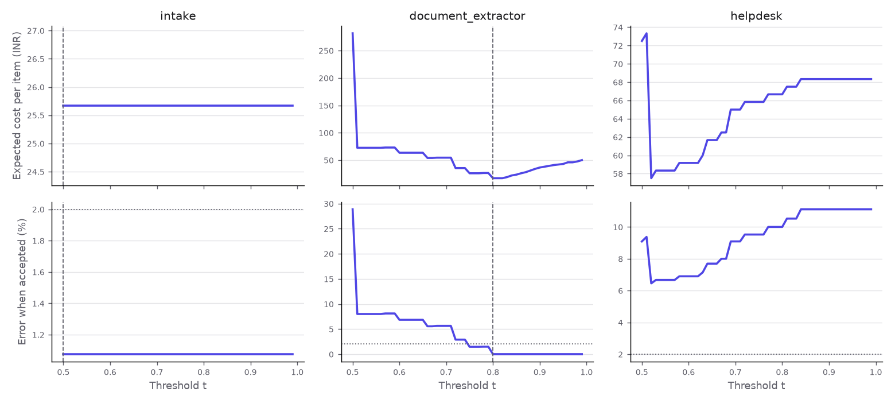

# Threshold report

Generated by `python evals/run.py` (PRD 13.4). Do not edit by hand.

- **Model provider:** `mock/deterministic` (offline mock; **no real model has been evaluated**)
- **Assumptions (`config/app.yaml`):** a person's time, C_human = ₹50; an uncaught error, C_error = ₹1000.
- **Rule:** pick t\* = argmin E(t), subject to P(error | accepted) ≤ 2%, for t from 0.50 to 0.99.
- **Formula:** E(t) = P(accept)·P(error|accept)·C_error + P(human)·C_human + mean model cost per item.
- **Data:** synthetic sets from `evals/generate_sets.py`, written by the same team as the skills. Treat these as a regression baseline, not as field accuracy. Reader confidence in the document set is an assumed distribution until real OCR runs on real scans.

## intake

**Measures the keyword table only.** With no real model, a message the table misses becomes `unknown` and goes to a person, so confidence is either 1 or 0 and the curve is flat. **This does not justify a model threshold.** Re-run with a real provider.

Labelled examples: 150.

**Chosen t\* = 0.50**: accepts 62.0% automatically, with 1.1% errors among those, sends 38.0% to a person, at an expected ₹25.67 per item.

| t | Accepted | Error when accepted | To a person | E(t) INR |
|---|---|---|---|---|
| 0.50 | 62.0% | 1.1% | 38.0% | 25.67 |
| 0.60 | 62.0% | 1.1% | 38.0% | 25.67 |
| 0.70 | 62.0% | 1.1% | 38.0% | 25.67 |
| 0.80 | 62.0% | 1.1% | 38.0% | 25.67 |
| 0.90 | 62.0% | 1.1% | 38.0% | 25.67 |
| 0.99 | 62.0% | 1.1% | 38.0% | 25.67 |

## document_extractor

Measures local parsing and validators, the path most documents take. Confidence is the weighted share of fields passing validators. No model fallback ran, so documents failing validators go to a person.

Labelled examples: 100.

**Chosen t\* = 0.80**: accepts 66.0% automatically, with 0.0% errors among those, sends 34.0% to a person, at an expected ₹17.00 per item.

| t | Accepted | Error when accepted | To a person | E(t) INR |
|---|---|---|---|---|
| 0.50 | 97.0% | 28.9% | 3.0% | 281.50 |
| 0.60 | 73.0% | 6.8% | 27.0% | 63.50 |
| 0.70 | 71.0% | 5.6% | 29.0% | 54.50 |
| 0.80 | 66.0% | 0.0% | 34.0% | 17.00 |
| 0.90 | 27.0% | 0.0% | 73.0% | 36.50 |
| 0.99 | 0.0% | 0.0% | 100.0% | 50.00 |

## helpdesk

Measures retrieval, which is what the similarity floor controls. Confidence is the top passage's coverage of the question. Answer wording is not evaluated here. If no threshold meets the limit, the manifest floor is a judgement, not a measurement: errors here are questions answered from the wrong passage, which a score cannot catch because the wrong passage does contain the words.

Labelled examples: 60.

**No threshold meets the error limit on this set.**

| t | Accepted | Error when accepted | To a person | E(t) INR |
|---|---|---|---|---|
| 0.50 | 55.0% | 9.1% | 45.0% | 72.50 |
| 0.60 | 48.3% | 6.9% | 51.7% | 59.17 |
| 0.70 | 36.7% | 9.1% | 63.3% | 65.00 |
| 0.80 | 33.3% | 10.0% | 66.7% | 66.67 |
| 0.90 | 30.0% | 11.1% | 70.0% | 68.33 |
| 0.99 | 30.0% | 11.1% | 70.0% | 68.33 |
